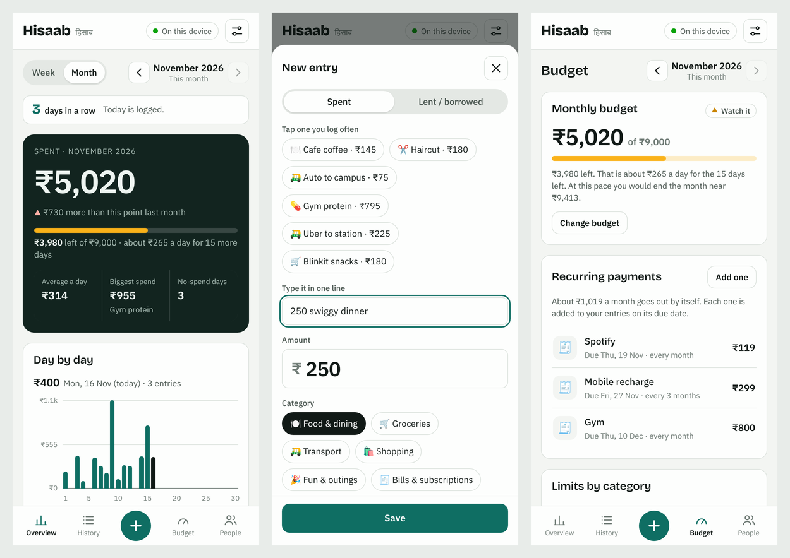
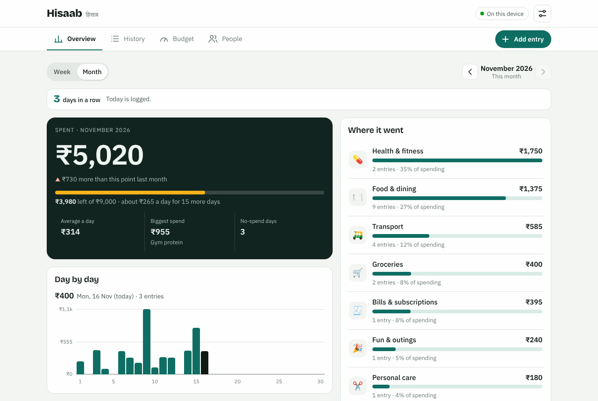

# Hisaab (हिसाब)

A private spending tracker that runs entirely in your browser. No server, no account, no API keys, nothing to renew. You install it on your phone like an app and it works with no internet.



## What it does

- **Add an expense in about 5 seconds.** Type `250 swiggy dinner` and press Enter. Hisaab reads the amount, guesses the category and saves it. Things you log often show up as tap-to-fill buttons.
- **See where the money goes.** Week and month totals, a comparison with the same point last week or month, day-by-day and six-period charts, and a category breakdown you can tap to see the entries behind it.
- **Budgets.** One limit for the month and optional limits per category, with "this much left per day" and a warning when your pace will overshoot.
- **Recurring payments.** Add a subscription, recharge or rent once. Hisaab enters it on the due date, and catches up if you did not open the app that day.
- **Lent and borrowed.** Record loans and shared bills. Each friend gets a running balance and a Settle up button. Lending never counts as spending.
- **A logging streak.** Manual tracking only works if you do it daily, so the app counts your days in a row and lets you mark a no-spend day.
- **Your data stays yours.** One tap downloads a backup file or a spreadsheet (.csv). Restore the backup on any device.

Full walkthrough of how it is built: [docs/HOW-IT-WORKS.md](docs/HOW-IT-WORKS.md).

On a laptop the same app uses the wider screen:



## Try it right now

Double-click `index.html`. It opens in your browser and works. Two things are switched off when it runs from a file instead of a web address: installing it as an app, and offline support. Entries you add this way stay with that file's copy, so use it to look around, then start for real on the hosted version below.

## Put it online with GitHub Pages (about 10 minutes, free)

You need a GitHub account. GitHub Pages is free for public repositories. The code will be public; your spending data never leaves your phone, so it is not in the repository.

1. On github.com, click **+** (top right), then **New repository**. Name it `hisaab`, keep it **Public**, leave "Add a README file" unticked, and click **Create repository**.
2. On the next page, click the link **uploading an existing file**.
3. Open this folder on your computer, select **everything inside it** (not the folder itself) and drag it onto the upload area. Folders such as `fonts` and `icons` upload with their contents. Wait until every file is listed.
4. Click **Commit changes**.
5. Go to **Settings**, then **Pages** in the left sidebar (under "Code and automation").
6. Under "Build and deployment", set **Source** to **Deploy from a branch**, pick the branch **main** and the folder **/ (root)**, then click **Save**.
7. Wait a minute or two and refresh that page. It shows your address: `https://YOUR-USERNAME.github.io/hisaab/`.

If you prefer the command line:

```bash
cd hisaab
git init -b main
git add .
git commit -m "Hisaab: first version"
git remote add origin https://github.com/YOUR-USERNAME/hisaab.git
git push -u origin main
```

Then do steps 5 to 7.

**Check it worked:** open the address, add one entry, close the tab, open it again. The entry should still be there. Then turn on flight mode and reload: the app should still open.

## Install it on your phone

- **Android (Chrome):** open your address, tap the **⋮** menu, then **Add to Home screen** or **Install app**. You can also use the Install button on the Setup screen (the sliders icon, top right).
- **iPhone (Safari):** open your address, tap **Share**, then **Add to Home Screen**.

On Android, long-press the app icon for an **Add entry** shortcut that opens straight into the form.

## Keeping your data safe

Your entries live in the browser storage of the one device you use. That is what makes the app private and maintenance-free, and it has three consequences:

- **No sync.** Your phone and laptop each have their own separate ledger.
- **Clearing the browser's site data, or uninstalling the app, deletes your entries.**
- **A backup file is the only copy outside the app.** Setup → Download backup. The app reminds you every 14 days once you have 15 entries. Keep the file somewhere other than the phone (email it to yourself, or put it in Google Drive).

To move to a new phone: download a backup on the old one, open Hisaab on the new one, then Setup → Restore from backup.

## Changing the app later

Edit a file on GitHub (open it, click the pencil, commit) or push from your computer. GitHub republishes in about a minute. Reload the app and you have the new version. If an old version sticks, close the app fully and open it again.

Where to make common changes:

| I want to... | Edit |
| --- | --- |
| Add, rename or reorder built-in categories, or their keywords | `EXPENSE_CATS` at the top of `app.js` |
| Add a payment mode (say, Wallet) | `MODES` at the top of `app.js` |
| Change colours or fonts | the `:root` block near the top of `styles.css` |
| Change how often the backup reminder appears | `backupDue` in `app.js` |
| Change the app name or icon | `manifest.webmanifest`, `index.html`, and the `icons` folder |

More recipes, including adding a new field or a new screen, are in [docs/HOW-IT-WORKS.md](docs/HOW-IT-WORKS.md).

## What is in this folder

| File | What it is |
| --- | --- |
| `index.html` | The page frame: header, an empty main area, the tab bar |
| `styles.css` | Every colour, font and layout rule |
| `app.js` | All behaviour, in nine numbered parts |
| `sw.js` | Service worker: keeps a copy of the app's files so it opens offline |
| `manifest.webmanifest` | Name, icons and colours the phone uses when installing |
| `icons/`, `fonts/` | App icons, and the two typefaces (shipped with the app, so nothing loads from another site) |
| `docs/` | The explainer and screenshots |
| `tests/run.js` | Automated checks that click through the app in a real browser |
| `.nojekyll` | Tells GitHub Pages to publish the files as they are |

There is no build step and no dependency to install. What is in the folder is what runs.

## Known limits

1. **One device, no sync.** By design, see above.
2. **Backups are manual,** and the file is saved on the same device until you move it.
3. **Manual entry only.** No bank, UPI or SMS import.
4. **No reminders.** A static site cannot send push notifications without a server.
5. **Recurring payments repeat by month only** (every 1, 3, 6 or 12 months). No weekly or every-28-days option.
6. **Built-in categories can only be changed in the code.** In the app you can add and remove your own.
7. **Spending only.** No income, so no savings rate or balance.
8. **No lock screen.** Anyone holding your unlocked phone can open the app.
9. **Storage ceiling.** Browsers give a site roughly 5 MB of this kind of storage. An entry takes about 235 characters, so the ceiling is around 20,000 entries.

## Ideas for the next versions

Each one maps to a limit above, roughly easiest first.

- **Weekly and every-N-days recurring** (limit 5): add a `unit` field to the rule and teach `nextDue` about days.
- **Income** (limit 7): add an `"income"` kind next to `"expense"`, a category list for it, and a "left this month" figure on the Overview.
- **Edit built-in categories in the app** (limit 6): move `EXPENSE_CATS` into settings, with the current list as the default.
- **Daily reminder** (limit 4): the simplest version is a phone alarm at 10 pm. The built version is a small bot that messages you a link to the app.
- **Share the backup straight to Drive or WhatsApp** (limit 2): use the Web Share API on the backup file.
- **Statement import** (limit 3): once you can download bank statements again, add a CSV import with a column picker that turns rows into entries through `makeRecord`.
- **Sync across devices** (limit 1): write a second storage backend with the same four functions as `localBackend` (for example Supabase with a login), and choose it in `boot()`.
- **App lock** (limit 8): a PIN screen, with the stored text encrypted using the Web Crypto API.
- **Bigger storage** (limit 9): move the store from localStorage to IndexedDB. Only part 4 of `app.js` changes.

## Tests

`tests/run.js` opens the app in a real browser and checks the calculations and every main flow: adding, editing, splitting a bill, budgets, recurring catch-up, the streak, backup and restore, the Back button, and loading with no internet.

```bash
npm install playwright             # once
npx playwright install chromium    # once: downloads the test browser
node tests/run.js                  # add a folder name to also save screenshots
```

To use a browser you already have, set `CHROME=/path/to/chrome` before the last command.

## Credits

Typefaces: IBM Plex Sans and Bricolage Grotesque, both under the SIL Open Font License (texts in `fonts/`). Everything else in this repository is the app's own code.
