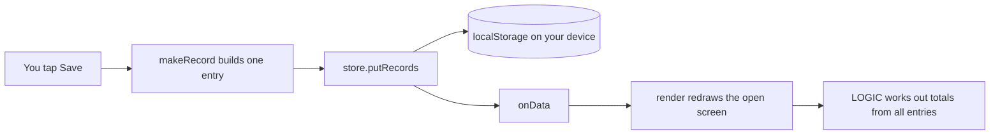

# How Hisaab works

This is the full explanation: what each file does, how the parts connect, why it was built this way, and how to change it. Read it top to bottom once and you can explain every part of the app.

## 1. The whole idea in one minute

Hisaab is a website with no backend. Three files do the work:

- `index.html` is the frame of the page.
- `styles.css` decides how it looks.
- `app.js` decides how it behaves.

Your entries are stored by the browser itself, on your device, in a feature called **localStorage**. Nothing is sent to any server, because there is no server. GitHub Pages only hands out the three files, the same way it would hand out a photo.

Everything the app does follows one loop:



The key rule: **totals are never stored.** The app stores only entries and settings. The week total, the budget bar, what a friend owes you: each is worked out again from the entries every time a screen is drawn. That is why editing or deleting one entry can never leave a wrong total behind.

## 2. Words you will need

| Word | Meaning here |
| --- | --- |
| **Static site** | A site made only of files. No program runs on a server. |
| **GitHub Pages** | GitHub's free hosting for static sites. It also provides and renews the HTTPS certificate. |
| **localStorage** | A small storage box the browser gives each website, kept on the device. It holds text. |
| **JSON** | A way to write data as text, for example `{"amount": 250}`. The app turns its data into JSON to store it and back again to use it. |
| **PWA** (progressive web app) | A website that can be installed and can work offline. Hisaab is one. |
| **Manifest** | A small file (`manifest.webmanifest`) that tells the phone the app's name, icon and colours. |
| **Service worker** | A script (`sw.js`) the browser runs beside the page. Hisaab uses it to keep a copy of its own files for offline use. |
| **Cache** | The place where the service worker keeps those copies. |
| **Pure function** | A function that only calculates: data in, answer out. It reads no screen and saves nothing, so it is easy to test and reuse. |

## 3. File by file

### index.html (about 50 lines)

The frame: a header (name, a status chip, the Setup button), an empty `<main id="view">`, the bottom tab bar, and empty holders for pop-up forms and the toast message. The `<head>` links the manifest, the icons and the stylesheet. The last line loads `app.js`, which fills `<main>`.

### styles.css (about 280 lines)

- **Fonts.** The two typefaces are files in `fonts/`, declared with `@font-face`. They are shipped with the app so that nothing loads from another website. The "latin-ext" files are there because they contain the rupee sign.
- **Design tokens.** The `:root` block names every colour and font once (`--accent`, `--ink`, `--surface`...). Everything else refers to these names. Dark mode is the same names with different values. To restyle the app you change this block.
- **Layout.** The body is a column: header, scrolling main area, tab bar. On screens 900px and wider, the tab bar moves under the header and cards sit in two columns.
- **Pieces.** Cards, rows, buttons, chips, the bar chart, meters, and the bottom sheet used for forms.

The bar charts are plain HTML boxes whose heights are percentages. There is no chart library.

### app.js (about 1,100 lines, nine numbered parts)

Each part has a banner comment in the file. In order:

**1. CONFIG.** The lists the app is built on: `EXPENSE_CATS` (each category has an id, name, icon and keyword list), `MODES` (UPI, Cash, Card), `REPEATS` (how often a recurring payment repeats) and `DEFAULT_SETTINGS`.

**2. HELPERS.** Small tools. The important ones:

- `dateKey` and `todayKey` turn a date into text like `2026-11-16`, using the phone's local time. Dates are stored as this text. Text dates sort correctly and never shift with time zones. (A common bug is using UTC, which in India shows yesterday's date until 5:30 am.)
- `round2` rounds money to two decimals, which avoids results like 0.30000000000000004.
- `inr` formats rupees with Indian grouping (₹1,23,456).
- `esc` makes typed text safe to place inside HTML.

**3. LOGIC.** Pure functions. This is the part to know best.

- `makeRecord` builds one entry with every field present.
- `getRange` returns a week or month as a list of days. Offset 0 is the current one, -1 the one before.
- `expensesIn`, `sum`, `totalsByDay`, `totalsByCategory`, `trendSeries` produce the numbers behind the Overview.
- `budgetStatus` compares spending with a limit and returns what is left, the allowance per remaining day, a projection for the month and a level: ok, warn (80% used, or on pace to overshoot) or over.
- `balances` works out who owes whom. Every loan or shared bill adds a plus or minus number against a person, and the total is the balance.
- `parseQuick` and `guessCategory` read a line like `250 swiggy dinner`. The category guess tries three things in order: an identical note you logged before, the built-in keywords, then any word you have used before.
- `nextDue` and `dueRecurring` handle recurring payments (section 6).
- `streak`, `regulars` and `backupDue` drive the streak strip, the tap-to-fill buttons and the backup reminder.

**4. STORE.** Saving and loading. `localBackend` keeps everything in one localStorage slot named `hisaab.v1`. The rest of the app never touches localStorage directly. It calls four functions: `putRecords`, `removeRecord`, `putSettings`, `wipe`. After each one, `onData` runs: it sorts the entries, remembers them in `state`, and calls `render`. `cleanSettings` fills in missing settings and drops malformed ones, so a damaged or hand-edited backup cannot break a screen. `boot` starts everything when the page opens.

**5. SCREENS.** Each screen is a function in `VIEWS` (`overview`, `history`, `budget`, `people`, `setup`) that receives the data and returns HTML as text. `render` puts that text on the page. If drawing a screen ever fails, `render` shows a message with a Download backup button instead of a blank page. There is no framework: the whole open screen is rebuilt on every change, which is instant at this size and keeps the code simple.

**6. SHEETS.** The pop-up forms: `openEntry` (add or edit), `openRecurring`, `openPerson`, `openLimit`, `openCategory`, plus `toast` and `confirmSheet`.

**7. EXPORT AND RESTORE.** `toCsv` builds the spreadsheet, `backupText` builds the backup, `saveFile` downloads either, `restore` reads a backup back in.

**8. WIRING.** One click listener for the whole page. Every button carries `data-act="name"`, and the listener runs `actions.name`. To find what a button does, read its `data-act` and look it up in the `actions` list.

**9. APP SHELL.** Registers the service worker, handles the Install button, asks the browser to protect the storage, and re-checks recurring payments when you return to the app.

### sw.js (about 60 lines)

The service worker. Its rule is "network first, saved copy as the fallback": online it fetches the newest file and saves a copy, offline it returns the saved copy, and if the network takes more than 2.5 seconds it uses the saved copy. It handles only the app's own files. Your entries are not in it.

### manifest.webmanifest

Name, short name, start address, colours and icons. It also defines the long-press shortcut "Add entry", which opens the app at `#add`.

## 4. What the data looks like

One entry:

```json
{
  "id": "mi0x3k2a9f1",
  "kind": "expense",
  "amount": 250,
  "date": "2026-11-16",
  "category": "food",
  "note": "swiggy dinner",
  "mode": "upi",
  "person": null,
  "split": null,
  "auto": null,
  "createdAt": "2026-11-15T19:31:02.114Z",
  "updatedAt": "2026-11-15T19:31:02.114Z"
}
```

- `kind` is `expense`, `gave` (you gave someone money) or `got` (someone gave you money).
- `amount` on an expense is always **your** share, the part that counts as your spending.
- `split` is filled for a shared bill: who paid, the full bill, and each friend's share.
- `auto` holds the id of the recurring payment that created the entry, or null.

Settings (one object):

```json
{
  "weekStart": 1,
  "defaultMode": "upi",
  "theme": "auto",
  "budgets": { "total": 9000, "cats": { "food": 4000 } },
  "customCats": [],
  "recurring": [
    { "id": "r_abc", "name": "Spotify", "amount": 119, "category": "bills", "mode": "upi", "every": 1, "day": 19, "next": "2026-11-19", "paused": false }
  ],
  "quietDays": ["2026-11-14"],
  "lastBackup": "2026-11-16"
}
```

## 5. Three walkthroughs

**You type `250 swiggy dinner` and press Enter.**

1. Each keystroke runs `parseQuick`, which fills the amount (250), the note, and the category (food, from the keyword "swiggy").
2. Enter submits the form. The code checks the amount is above zero and calls `makeRecord`.
3. `save` calls `store.putRecords`. The store adds the entry, writes everything to localStorage, then calls `onData`.
4. `onData` calls `render`. The Overview is rebuilt, so the total, charts and budget bar all include the new entry.

**You open the app on the 20th and Spotify was due on the 19th.**

1. `boot` calls `postRecurring`, which calls `dueRecurring(rules, today)`.
2. For each rule, while its `next` date is today or earlier, it creates an entry dated `next` and moves `next` forward with `nextDue`.
3. The entry's id is fixed: `auto_` + the rule's id + the date. If this ran twice, the second run would write the same id again instead of adding a duplicate.
4. The entries are saved first, then the rules with their new dates.

If you had not opened the app for three months, the loop adds all three payments.

**You open the app with no internet.**

1. The browser asks for `index.html`. The request goes through the service worker.
2. The network fails, so the service worker returns its saved copy. The same happens for the CSS, the script and the fonts.
3. `app.js` runs and reads your entries from localStorage, which is on the device. Everything works, including adding entries.

## 6. Why it was built this way

**Why no server or database?** The earlier version of this tracker (a Telegram bot, an automation server, an AI call and Google Sheets) stopped working when an SSL certificate expired and a connection dropped. Every moving part is something that can break or expire. This version has none: the host renews its own certificate, and the data needs no connection.

**Why localStorage?** It is the simplest storage a browser has: one line to save, one to load, available everywhere. The cost is a size ceiling (around 20,000 entries) and that it lives on one device. One detail worth knowing: every site under `your-username.github.io` shares the same storage box, so Hisaab keeps its data under its own slot name (`hisaab.v1`) and will not collide with other Pages sites you publish.

**Why no framework such as React?** With one user and a few hundred entries, rebuilding a screen from text takes a few milliseconds. No framework means no build step, no dependencies to update, and code that runs exactly as written.

**Why store dates as text?** `2026-11-16` sorts correctly as plain text, compares with `<` and `>`, and cannot shift across time zones.

**Why are totals never stored?** Stored totals can drift from the entries after an edit or a crash. Calculated totals cannot.

**Why "network first" in the service worker?** A "cache first" app keeps showing an old version after you update the code, which is confusing while you are still changing it. Network first always shows the newest version when online and still works offline.

**Why ship the fonts?** So the app makes no request to any other website. That keeps it fully working offline and private.

**Why does a shared bill count only your share?** Your spending is what you consumed. If you paid ₹520 and ₹340 was your friend's, your spending is ₹180 and they owe you ₹340.

## 7. Questions you may be asked

**Where is the data stored, and is it secure?** On the user's device, in the browser's storage for this site. It is never transmitted, so there is nothing to intercept or leak from a server. Anyone with the unlocked phone could open the app, the same as a notes app.

**What happens if the phone is lost?** The entries are lost unless there is a backup file. The app reminds you to download one every 14 days.

**How does it work offline?** A service worker saves the app's files on first visit and serves them when there is no network. The data is already on the device.

**Why did you not use a database?** One user and small data. A database adds hosting, credentials and a network dependency, which is exactly what failed last time.

**How would you add sync?** The app talks to storage through four functions. A second backend with the same four functions (for example Supabase with a login) can replace the local one in `boot()` without touching the screens.

**How do you know the calculations are right?** `tests/run.js` runs 100 checks in a real browser: date ranges, rounding, budget levels, recurring catch-up across month ends and leap years, split-bill balances, backup and restore, and loading offline.

**How does the category guess work?** Three steps: an identical earlier note, then built-in keywords, then any word used before. It learns from your own history, with no AI call.

**What stops a recurring payment being added twice?** Its id is built from the rule and the date, so saving it again overwrites the same entry.

## 8. How to change things

**Add a category.** In `app.js` part 1, add a line to `EXPENSE_CATS`:

```js
{ id: "travel", name: "Travel", icon: "🧳", words: ["hotel", "ticket", "trip"] },
```

Keep `other` as the last item. The `id` must be unique and should not change later, because entries refer to it.

**Add a payment mode.** Add `{ id: "wallet", name: "Wallet" }` to `MODES`.

**Change the colours.** In `styles.css`, edit `--accent` and friends in `:root`, and the matching dark values in the two blocks below it.

**Add a field to every entry (say, a tag).**

1. In `makeRecord`, add `tag: f.tag ?? null`.
2. In `openEntry`, add an input to the form, fill it from `src.tag`, and include `tag` in `fields` when the form is submitted.
3. Show it in `recordRow` and add a column in `toCsv`.

Old entries simply have no tag, which the `?? null` handles.

**Add a new screen.**

1. Add its name to `TABS` in part 1.
2. Add a function with that name to `VIEWS` that returns HTML.
3. Add a button to the tab bar in `index.html` with `data-act="go" data-tab="yourname"`, and in `styles.css` change `repeat(5, 1fr)` in `.tabs` to 6 so the bar has room for it.

**Add a new button that does something.** Give it `data-act="my-thing"` and add `"my-thing": el => { ... }` to `actions` in part 8.

**After any change:** run `node tests/run.js` if you can, then commit. The site updates in about a minute.

## 9. Rebuilding it yourself

A sensible order, each step small enough to do with an AI assistant and check by hand:

1. A page with an amount box and a list. Adding puts a row in the list.
2. Save the list to localStorage, load it on start.
3. Add date and category. Show totals for this week and this month.
4. Edit and delete.
5. A category breakdown and a day-by-day chart.
6. Monthly budget with a progress bar.
7. Lent and borrowed, as plus and minus entries per person.
8. Recurring rules with a `next` date, applied when the app opens.
9. Backup download and restore.
10. Manifest and service worker, then publish on GitHub Pages.

A prompt pattern that works: paste the current file, state one change, and ask for the smallest edit, for example: "Here is my app.js. Add a weekly option to recurring payments. Change only `REPEATS`, `nextDue` and the recurring form. Show me the edits."

## 10. Limits, and how to lift each one

The README lists the known limits and an upgrade for each. The three that matter most:

- **One device.** Fix with a second storage backend (see "How would you add sync?").
- **Manual backups.** Fix with a Share button that sends the backup file to Drive, or automatic upload once sync exists.
- **Manual entry.** Fix with statement import when bank statements are available again.
